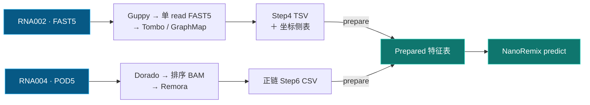

<h1 align="center">NanoRemix</h1>

<p align="center"><strong>Oxford Nanopore 直接 RNA 测序的逐 read 修饰预测</strong></p>

<p align="center">
  RNA002 与 RNA004 · Binary 与 Multi · Nanopore 信号与序列融合
</p>

<p align="center">
  <a href="https://github.com/iris982022/nanoremix_tool/actions/workflows/tests.yml"></a>
  <br>
  源码 <strong>v0.3.1</strong> · 模型 <strong>v0.3.0</strong> · 建议 Python <strong>3.10 / 3.11</strong>
</p>

<div align="center">

[功能与支持范围](#2-支持哪些试剂和修饰) · [预处理](#3-如何准备输入) · [参数速查](#4-常用参数) · [快速上手](#5-快速上手) · [运行模型](#6-运行自己的数据)

**[完整中文手册](docs/README.zh-CN.md)** · **[模型下载](https://github.com/iris982022/nanoremix_tool/releases/tag/v0.3.0)**

</div>

---

## 1. NanoRemix 能做什么

| 我想做什么 | 命令 | 会得到什么 |
| --- | --- | --- |
| 把已有信号特征整理成模型输入 | `prepare` | RNA002 Step4/extracted 或 RNA004 正链 Step6 转出的特征表 |
| 先核对支持范围和运行条件 | `catalog`、`doctor`、`validate` | 类别清单、模型与依赖预检、输入与推理试跑结果 |
| 跑纯三代、二代＋三代融合或纯二代 | `predict` | 逐 read 候选的标签和概率，以及筛选记录与运行清单 |

## 2. 支持哪些试剂和修饰

按实验使用的 ONT 试剂选择 RNA002 或 RNA004，再按任务选择 Binary 或 Multi。特征表每行对应一条 read 上的一个候选位置。

| 配置 | 支持的修饰 | 三代特征输入 |
| --- | --- | --- |
| [RNA002 Binary](docs/README.zh-CN.md#rna002-binary) | m6A、m5C、假尿苷（`pseudoU`），各与对应未修饰碱基比较 | 9 nt 上下文 + 20 个信号特征 |
| [RNA002 Multi](docs/README.zh-CN.md#rna002-multi) | 14 种。m6A、m1A、Inosine、Am、m5C、hm5C、ac4C、FormylC、m7G、o8G、pseudoU、m1psi、m5U、Um | 9 nt 上下文 + 20 个信号特征 |
| [RNA004 Binary](docs/README.zh-CN.md#rna004-binary) | m6A、m5C、假尿苷（`pseudoU`），各与对应未修饰碱基比较 | 17 nt 上下文 + 36 个信号特征 |
| [RNA004 Multi](docs/README.zh-CN.md#rna004-multi) | 12 种。m6A、m1A、Am、m5C、hm5C、ac4C、o8G、Gm、pseudoU、m1psi、m5U、Um | 17 nt 上下文 + 36 个信号特征 |

Multi 在同一参考碱基家族内比较所选类别，使用 `--mods` 时默认加入相应未修饰对照。以下是两种常用路线。

- **只有 Nanopore 特征或三代概率**，选 `--mode thirdgen`。
- **还想结合序列证据**，选 `--data-type biological`。另提供同中心的 **81 nt** 序列与 SecondGen 模型，或完整的 **15 类二代概率**。融合无需额外进行 Illumina 测序。[全部预测路线](docs/README.zh-CN.md#choose)

## 3. 如何准备输入

从 FAST5 或 POD5 开始，先在上游完成 basecalling、比对和信号提取。已有规范特征表或概率表时，可直接运行 `predict`。



- **RNA002** 用 Guppy 的 `--fast5_out` 保留 basecalled FAST5，提取后保留 Step4 TSV 与同步坐标侧表。转换时指定 `--chemistry RNA002 --format step4`。
- **RNA004** 用 Dorado 的 `--emit-moves` 保留信号定位所需的 move table，合并 Remora 特征得到 Step6 CSV。转换时指定 `--chemistry RNA004 --format step6`。

两个转换命令均使用 `nanoremix prepare --input <上游表> --output <新文件>`。特征表使用带表头的 CSV/TSV，可 gzip 压缩。`9mer_final` 保存短序列上下文，信号为 mean、median、std、length 四组列，每组 RNA002 有 5 列、RNA004 有 9 列。[上游命令和格式示例](docs/README.zh-CN.md#preprocessing) · [预测输入字段](docs/README.zh-CN.md#inputs)

> [!IMPORTANT]
> RNA004 的旧 Step6 转换要求显式 `strand=+`。负链数据需要先用经过验证的流程构造符合规范的 prepared 表，再运行预测。[RNA004 使用限制](docs/KNOWN_LIMITATIONS.zh-CN.md)

## 4. 常用参数

以下选项用于 `predict`，也适用于 `validate`。用 `--input` 指定输入表，预测时用 `--output` 指定新目录。

| 参数 | 怎么选 |
| --- | --- |
| `--chemistry RNA002` / `RNA004` | 选实验使用的试剂版本。 |
| `--task binary` / `multi` | 选修饰与未修饰配对，或同一参考碱基家族内的多类比较。 |
| `--mods m6A,m5C` / `all` | 选修饰列表或当前路线支持的全部修饰，默认加入同家族未修饰对照。Multi 可用 `--targets` 直接列出参与比较的类别。 |
| `--mode thirdgen` / `--data-type biological` | 分别运行纯三代或融合。`--mode` 与 `--data-type` 二选一。 |
| `--strategy s1` / `s2` / `both` | 默认 `s2`，`both` 分别输出两种策略的结果。 |
| `--input-kind features` / `probabilities` | 默认读特征表。已有三代概率时选 `probabilities`。 |
| `--sequence-column sequence81` | 指定用于二代推理的 81 nt 序列列。已有独立二代概率表时可用 `--second-probabilities` 和 `--join-on` 按观测键匹配。 |
| `--model-root models` | 指定模型根目录。加载已核实的权重时需同时使用 `--trust-model-files`，可用 `--model-checksums models/SHA256.json` 检查文件。 |
| `--min-confidence 0.8` / `--output-filter modified` | 分别设置获胜类别的条件概率下限、仅保存已接受的修饰预测。这里的 0.8 是示例，默认下限为 0，默认保存所有候选。 |

[全部参数、默认值和使用条件](docs/README.zh-CN.md#options)

## 5. 快速上手

用两条人工概率记录检查安装。这个示例无需下载模型权重。

```bash
git clone https://github.com/iris982022/nanoremix_tool.git
cd nanoremix_tool
python -m venv .venv
source .venv/bin/activate
python -m pip install -e .

nanoremix predict --input examples/minimal_binary_probabilities.csv \
  --chemistry RNA004 --task binary --mods m6A \
  --input-kind probabilities --mode thirdgen --strategy s2 \
  --output results/quickstart
```

在 `results/quickstart/thirdgen/s2/predictions.tsv` 中可看到两条预测，依次为 `m6A` 和 `A`。每次运行请选择新的输出目录。

## 6. 运行自己的数据

以下以 **RNA004 Binary → m6A → 纯三代 S2** 为例。先从 Release 下载 RNA004 Binary ZIP，解压到仓库根目录生成 `models/`。命令用仓库附带的人工特征表调用发布模型；运行自己的样本时，将 `--input` 换成同格式的特征表。[下载 RNA004 Binary 模型](https://github.com/iris982022/nanoremix_tool/releases/download/v0.3.0/NanoRemix_v0.3.0_models_RNA004_Binary_20261104.zip) · [安装与模型预检](docs/README.zh-CN.md#start-install)

```bash
python -m pip install -e '.[models]' -c constraints-models.txt

nanoremix predict \
  --input docs/guide_20261104/examples/RNA004_prepared_with81.csv \
  --chemistry RNA004 --task binary --mods m6A \
  --mode thirdgen --strategy s2 \
  --model-root models --model-checksums models/SHA256.json --trust-model-files \
  --output results/rna004_m6a
```

| 文件（位于 `results/rna004_m6a/`） | 查看什么 |
| --- | --- |
| `thirdgen/s2/predictions.tsv` | 预测标签、类别概率和置信度 |
| `thirdgen/s2/selection_audit.tsv` | 全部输入候选的处理状态及筛选原因 |
| `run_manifest.json` | 实际运行的模式、策略、类别、输入和模型哈希 |

[四套配置的完整命令](docs/README.zh-CN.md#start-run) · [结果分析](docs/README.zh-CN.md#outputs)
